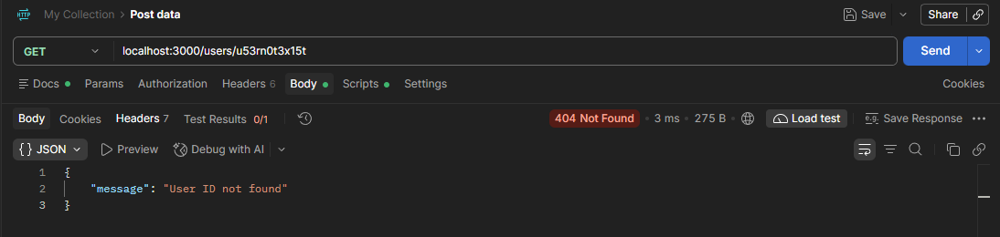

# Tripleten web_project_around_express

# Around Express

API REST construida con Express y TypeScript que sirve los datos de usuarios y tarjetas de la aplicación **Around the U.S.** a partir de archivos JSON locales.

## Descripción

Este proyecto es el backend de Around the U.S. Expone una API que lee los archivos `users.json` y `cards.json` y devuelve su contenido en formato JSON. También permite consultar un usuario específico por su identificador.

### Funcionalidad

| Método | Ruta          | Descripción                             |
| ------ | ------------- | --------------------------------------- |
| GET    | `/users`      | Devuelve la lista completa de usuarios  |
| GET    | `/users/:_id` | Devuelve el usuario cuyo `_id` coincide |
| GET    | `/cards`      | Devuelve la lista completa de tarjetas  |

Ejemplo:

```
GET http://localhost:3000/users/8340d0ec33270a25f2413b69
```

```json
{
  "name": "Katherine Johnson",
  "about": "Mathematician",
  "avatar": "https://...",
  "_id": "8340d0ec33270a25f2413b69"
}
```

### Manejo de errores

Todas las respuestas de error contienen únicamente el campo `message`.

| Estatus | Cuándo ocurre                                                     | Respuesta                                              |
| ------- | ----------------------------------------------------------------- | ------------------------------------------------------ |
| 404     | No existe un usuario con el `_id` solicitado                      | `{ "message": "User ID not found" }`                   |
| 404     | La ruta solicitada no existe                                      | `{ "message": "Requested resource not found" }`        |
| 500     | Error inesperado (por ejemplo, fallo al leer un archivo de datos) | `{ "message": "An error has occurred on the server" }` |

## Tecnologías y técnicas utilizadas

- **Node.js** como entorno de ejecución.
- **Express** para el servidor y el enrutamiento.
- **TypeScript** para tipado estático (interfaces `User` y `Card`).
- **ES Modules** (`import` / `export`).
- **`node:fs/promises`** para leer los archivos de datos de forma asíncrona.
- **`node:path` e `import.meta.dirname`** para construir rutas absolutas a los archivos de datos de forma segura.
- **ESLint** y **Prettier** para mantener la calidad y el estilo del código.
- **EditorConfig** para uniformar el formato entre editores.
- **Arquitectura por capas:** rutas (`router`), controladores (`controller`), middleware y tipos (`types`).
- **Manejo de errores** con `try/catch` en cada controlador y un controlador para rutas inexistentes.

## Estructura del proyecto

```
├── data/
│   ├── cards.json
│   └── users.json
├── src/
│   ├── controller/   # Lógica de cada ruta
│   ├── middleware/   # Middleware (logger)
│   ├── router/       # Definición de rutas
│   ├── types/        # Interfaces de TypeScript
│   └── index.ts      # Punto de entrada del servidor
├── eslint.config.js
├── package.json
└── tsconfig.json
```

## Instalación y uso

```bash
# Clonar el repositorio e instalar dependencias
git clone <URL-DEL-REPOSITORIO>
cd web_project_around_express
npm install
```

### Scripts disponibles

| Comando         | Descripción                                                           |
| --------------- | --------------------------------------------------------------------- |
| `npm run dev`   | Inicia el servidor en `localhost:3000` con recarga en caliente        |
| `npm run build` | Compila el código de `src` a JavaScript en la carpeta `dist`          |
| `npm run start` | Inicia en `localhost:3000` la versión compilada (ejecuta antes build) |
| `npm run lint`  | Ejecuta ESLint sobre el proyecto                                      |

## Capturas de pantalla

### GET /users


### GET /users/:_id


### Error 404: usuario no encontrado



### Error 404: ruta inexistente


