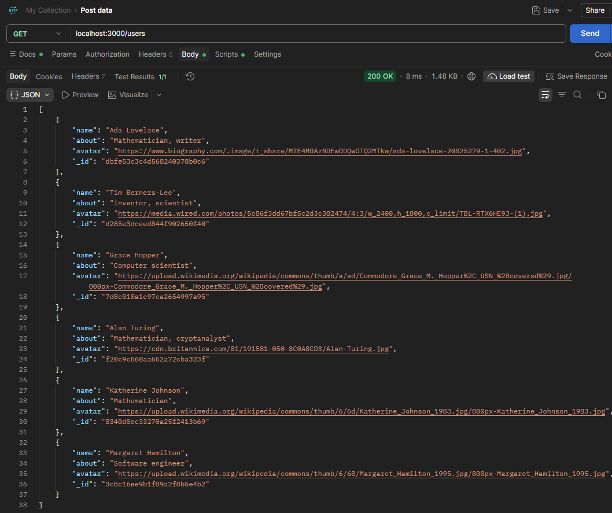
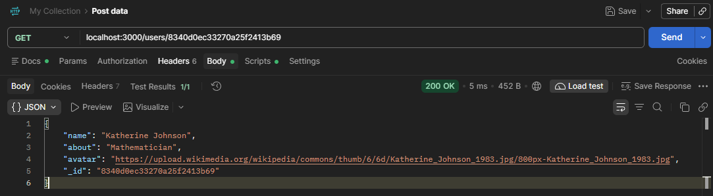
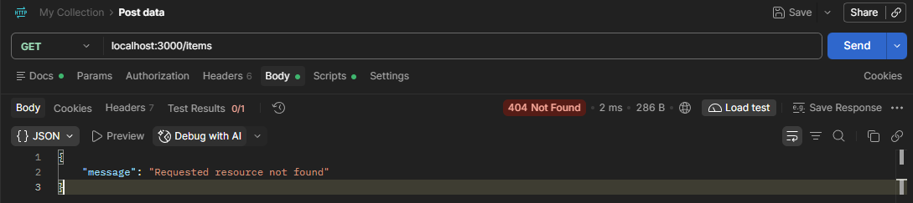

# Around Express

API REST construida con **Express**, **TypeScript** y **MongoDB (Mongoose)** que sirve los datos de usuarios y tarjetas de la aplicación **Around the U.S.**

## Descripción

Este proyecto es el backend de Around the U.S. Almacena usuarios y tarjetas en una base de datos MongoDB y expone endpoints para crearlos, consultarlos, actualizarlos y eliminarlos. Las tarjetas admiten likes, y cada respuesta incluye el campo calculado `isLiked`, que indica si el usuario actual le dio like.

> **Nota:** mientras no exista autenticación, un middleware temporal asigna un usuario fijo a `req.user` en cada petición. Será reemplazado cuando se implemente la autorización.

## Funcionalidad

### Usuarios

| Método | Ruta               | Descripción                                 |
| ------ | ------------------ | ------------------------------------------- |
| GET    | `/users`           | Devuelve la lista de usuarios               |
| GET    | `/users/:id`       | Devuelve el usuario cuyo `_id` coincide     |
| POST   | `/users`           | Crea un usuario (`name`, `about`, `avatar`) |
| PATCH  | `/users/me`        | Actualiza el perfil (`name`, `about`)       |
| PATCH  | `/users/me/avatar` | Actualiza el avatar (`avatar`)              |

### Tarjetas

| Método | Ruta               | Descripción                       |
| ------ | ------------------ | --------------------------------- |
| GET    | `/cards`           | Devuelve todas las tarjetas       |
| POST   | `/cards`           | Crea una tarjeta (`name`, `link`) |
| DELETE | `/cards/:id`       | Elimina una tarjeta               |
| PUT    | `/cards/:id/likes` | Da like a una tarjeta             |
| DELETE | `/cards/:id/likes` | Quita el like de una tarjeta      |

### Ejemplos

Crear un usuario:

```
POST http://localhost:3000/users
```

```json
{
  "name": "Ana Pérez",
  "about": "Exploradora",
  "avatar": "https://images.unsplash.com/photo-1494790108377-be9c29b29330"
}
```

Respuesta de una tarjeta:

```json
{
  "_id": "665f1c2a9b1e8a3d4c5b6a7f",
  "name": "Valle del Cocora",
  "link": "https://...",
  "owner": "6b04bf15648f9ab4cd0b1891",
  "likes": ["6b04bf15648f9ab4cd0b1891"],
  "createdAt": "2026-11-23T10:00:00.000Z",
  "isLiked": true
}
```

## Modelos

**User**

| Campo    | Tipo   | Reglas      |
| -------- | ------ | ----------- |
| `name`   | String | Obligatorio |
| `about`  | String | Obligatorio |
| `avatar` | String | Obligatorio |

**Card**

| Campo       | Tipo                    | Reglas                         |
| ----------- | ----------------------- | ------------------------------ |
| `name`      | String                  | Obligatorio, 2 a 30 caracteres |
| `link`      | String                  | Obligatorio                    |
| `owner`     | ObjectId (ref `User`)   | Obligatorio                    |
| `likes`     | [ObjectId] (ref `User`) | Vacío por defecto              |
| `createdAt` | Date                    | Valor por defecto `Date.now`   |

## Manejo de errores

Todas las respuestas de error contienen únicamente el campo `message`. Los errores se lanzan con `throw` desde los controladores y se procesan en un middleware centralizado.

| Estatus | Cuándo ocurre                                             | Respuesta de ejemplo                                         |
| ------- | --------------------------------------------------------- | ------------------------------------------------------------ |
| 400     | ID inválido o datos que no pasan la validación del modelo | `{ "message": "ID inválido" }`                               |
| 401     | No hay un usuario asignado a la petición                  | `{ "message": "No autorizado" }`                             |
| 404     | No existe el usuario o la tarjeta con el `id` solicitado  | `{ "message": "No se encontró ninguna tarjeta con ese id" }` |
| 404     | La ruta solicitada no existe                              | `{ "message": "Ruta GET /ruta no encontrada" }`              |
| 500     | Error inesperado del servidor                             | `{ "message": "Ha ocurrido un error en el servidor" }`       |

## Tecnologías y técnicas utilizadas

- **Node.js** como entorno de ejecución.
- **Express 5** para el servidor y el enrutamiento (los errores de handlers `async` llegan solos al middleware de errores).
- **TypeScript** con tipado estático y extensión del tipo `Request` para `req.user`.
- **MongoDB** y **Mongoose** para modelos, validaciones y consultas.
- **Operadores atómicos de MongoDB** (`$addToSet`, `$pull`) para gestionar los likes.
- **ES Modules** (`import` / `export`).
- **ESLint** y **Prettier** para mantener la calidad y el estilo del código.
- **EditorConfig** para uniformar el formato entre editores.
- **Arquitectura por capas:** rutas, controladores, modelos, middleware y tipos.
- **Middleware centralizado de errores** y manejo de rutas inexistentes.

## Estructura del proyecto

```
├── src/
│   ├── controllers/   # Lógica de cada ruta
│   ├── middleware/    # Logger y manejo de errores
│   ├── models/        # Esquemas y modelos de Mongoose
│   ├── routes/        # Definición de rutas
│   ├── types/         # Extensión del tipo Request (express.d.ts)
│   └── app.ts         # Punto de entrada: conexión, middleware y servidor
├── eslint.config.js
├── package.json
└── tsconfig.json
```

## Requisitos previos

- [Node.js](https://nodejs.org/) instalado.
- [MongoDB](https://www.mongodb.com/) en ejecución en `mongodb://127.0.0.1:27017`.

## Instalación y uso

```bash
# Clonar el repositorio e instalar dependencias
git clone <URL-DEL-REPOSITORIO>
cd web_project_around_express
npm install
```

Asegúrate de que MongoDB esté corriendo y luego inicia el servidor:

```bash
npm run dev
```

### Scripts disponibles

| Comando         | Descripción                                                           |
| --------------- | --------------------------------------------------------------------- |
| `npm run dev`   | Inicia el servidor en `localhost:3000` con recarga en caliente        |
| `npm run build` | Compila el código de `src` a JavaScript en la carpeta `dist`          |
| `npm run start` | Inicia en `localhost:3000` la versión compilada (ejecuta antes build) |
| `npm run lint`  | Ejecuta ESLint sobre el proyecto                                      |

## Usuario temporal

Mientras no exista autenticación, el middleware de `app.ts` asigna a `req.user` el `_id` de un usuario existente en la base de datos. Para probar el proyecto:

1. Crea un usuario con `POST /users` y copia su `_id`.
2. Pega ese `_id` en el middleware de `app.ts`.
3. Reinicia el servidor si no usas recarga en caliente.

## Capturas de pantalla

### GET /users



### GET /users/:id



### Error 404: usuario no encontrado


### Error 404: ruta inexistente


